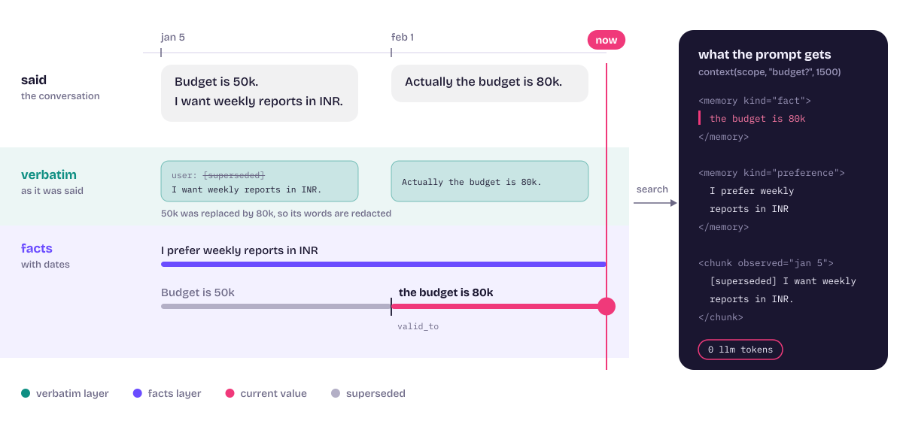
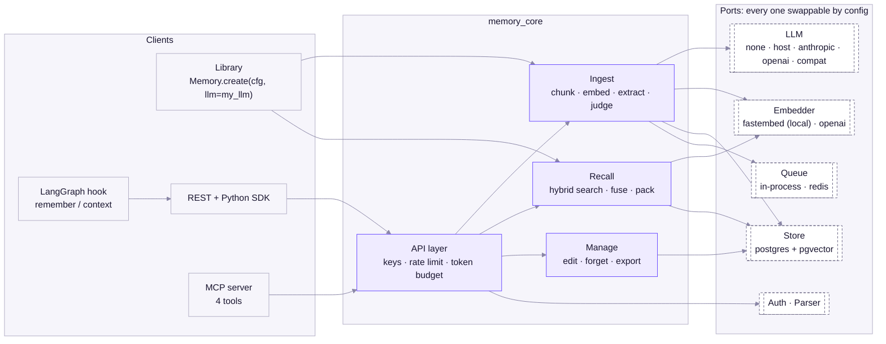
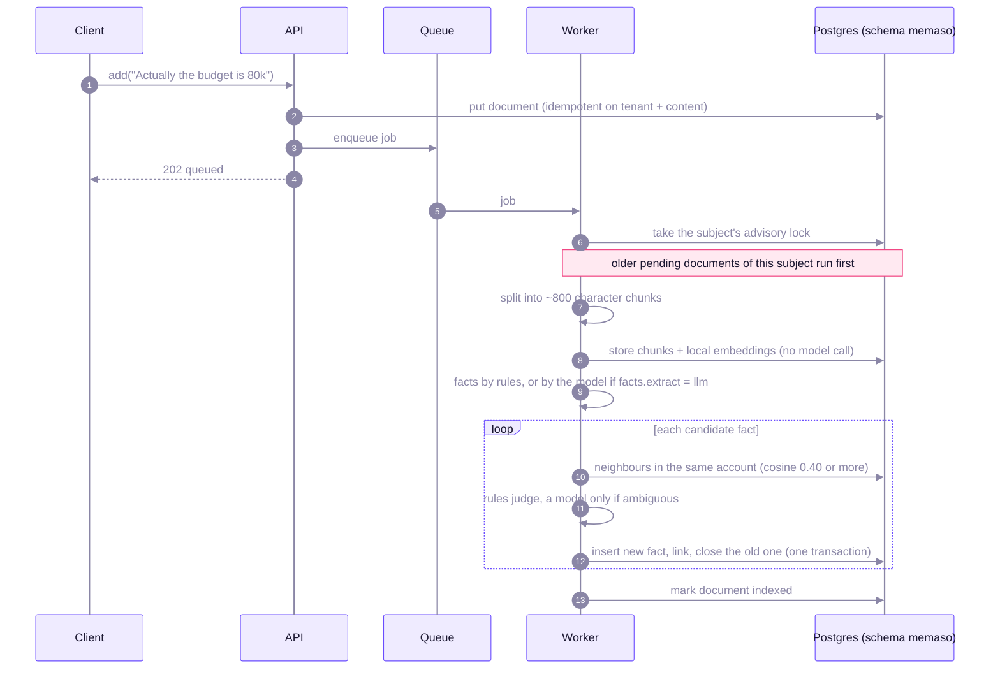
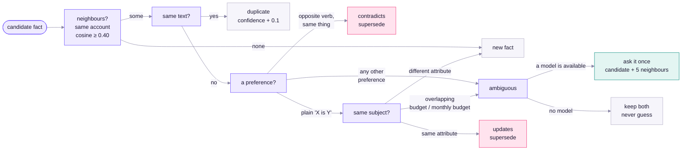
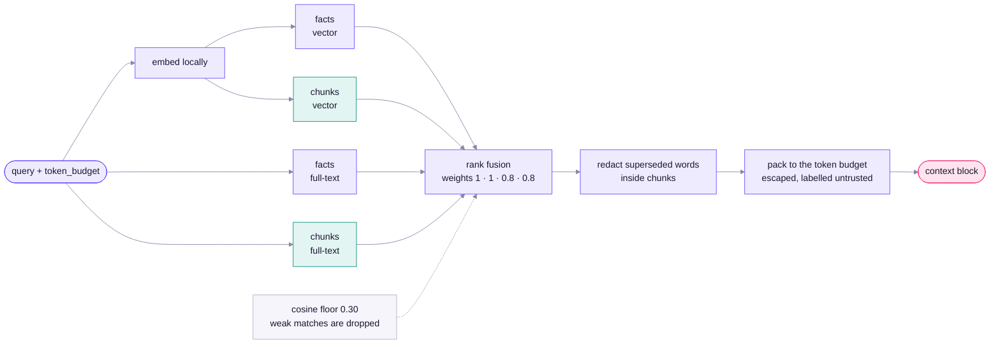
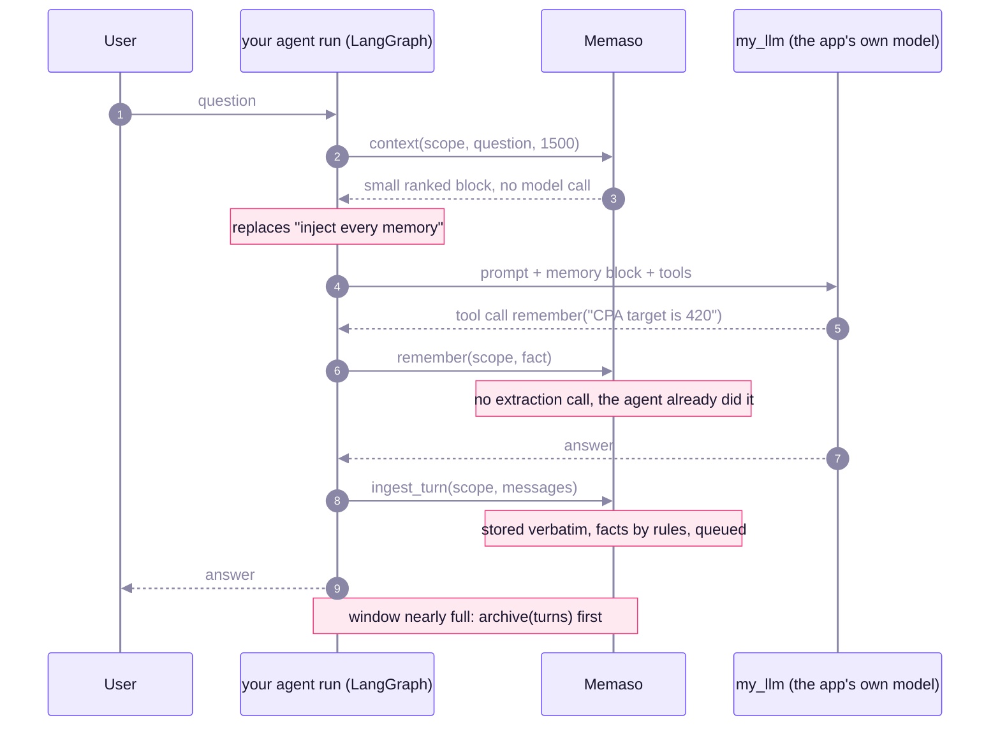
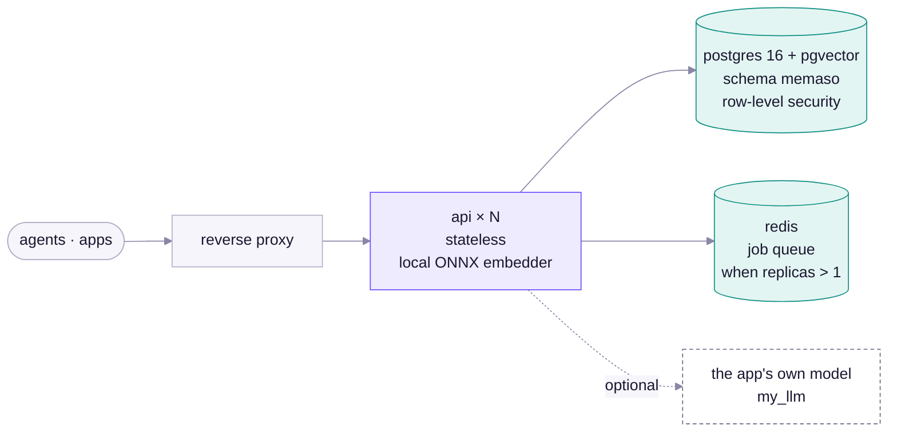
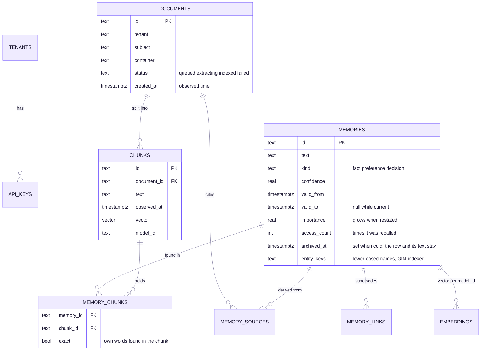

<p align="center">
  <picture>
    <source media="(prefers-color-scheme: dark)" srcset="assets/logo-dark.svg">
    
  </picture>
</p>

<h3 align="center">Memory for AI agents that stays true as things change.</h3>

<p align="center">
  Stores what was said, keeps the facts inside it dated, and recalls a small ranked block within a token budget.<br>
  No model is required. Bring your own when you want one.
</p>

<p align="center">
  <a href="#quick-start">Quick start</a> &nbsp;·&nbsp;
  <a href="#how-it-works">How it works</a> &nbsp;·&nbsp;
  <a href="#use-it-inside-your-agent-backend">Library mode</a> &nbsp;·&nbsp;
  <a href="#run-it-as-a-service">Service</a> &nbsp;·&nbsp;
  <a href="#swap-anything">Configuration</a> &nbsp;·&nbsp;
  <a href="#guarantees-and-known-limits">Limits</a>
</p>

<p align="center">
  
  
  
  
</p>

<p align="center">
  <picture>
    <source media="(prefers-color-scheme: dark)" srcset="assets/hero-dark.svg">
    
  </picture>
</p>

## What it does

- **Remembers the words and the facts.** Every turn is kept verbatim (searchable, nothing lost to a summary) and mined for facts that carry `valid_from` and `valid_to`, so "the budget is 80k" closes "the budget is 50k" instead of sitting beside it.
- **Recalls cheaply.** Search is embeddings plus full-text, fused, then packed to the token budget you give it. It makes no model call.
- **Uses a model only where one helps.** Plain statements are read by rules. A model (your app's own, or one you configure) is asked only when a case is genuinely ambiguous.
- **Stays inside the lines.** Row-level tenant isolation, account scoping, real deletion, and recalled text that is escaped and labelled as untrusted data.
- **Looks after itself.** Facts carry an importance score and fade with disuse. `consolidate` merges duplicate facts and archives cold, low-value ones (kept, not deleted). An entity graph links facts through the names in them, so a question about a person reaches the account facts behind them. No model is involved in any of it.
- **Fits an existing backend.** Library mode runs in-process on your Postgres, in its own schema, with hooks for the run loop, context compaction and the tool registry.

## How it works

### Architecture



Core code depends on the ports only. `tests/unit/test_import_discipline.py` fails the build if a core file imports an adapter or a vendor SDK.

### A conversation, end to end



### Facts that know when they stopped being true



A fact is never overwritten. The old one keeps its history (`valid_to` is set), so `as_of` queries can still answer "what did we think on March 1" and `include_history` shows everything. Forgetting a value never brings an older one back.

### Recall



A chunk whose words were superseded stays searchable: only the superseded span is replaced by `[superseded]`, so the rest of the chunk is never hidden.

## Quick start

```bash
docker compose up -d                    # Postgres + pgvector, and the API. No model, no key.
docker compose run --rm migrate python -m memory_core create-tenant acme
docker compose run --rm migrate python -m memory_core create-key acme --subject alice   # printed once
docker compose port api 8080            # REST here; OpenAPI at /openapi.json
```

```python
from memory_core.sdk import MemoryClient

m = MemoryClient("http://localhost:8080", "mc_...", subject="alice")
await m.add("Budget is 50k. I want weekly reports in INR.")
await m.add("Actually the budget is 80k.")             # closes the 50k fact
res = await m.search("what is the budget?")             # res.context goes into your prompt
```

The first start downloads a ~90 MB embedding model and caches it in a volume. Docker is optional: see [Run it as a service](#run-it-as-a-service).

## Use it inside your agent backend



```python
from memory_core.memory import Memory
from memory_core.types import Scope

mem = await Memory.create("config.yaml", llm=my_llm)    # llm=None: no model at all
scope = Scope(tenant=team_id, subject=user_id, container=ad_account_id)

block = await mem.context(scope, user_text, token_budget=1500)   # replaces "inject every memory"
await mem.remember(scope, "CPA target is 420", kind="fact")      # the agent's own tool call
await mem.ingest_turn(scope, messages)                           # after the answer: verbatim, queued
await mem.archive(scope, old_turns)                              # before compaction summarises them
```

`tenant` is the team, `subject` the user, `container` the ad account. A fact stored with no container is global and shows up in every account; an account fact stays in its account, and supersession only compares facts inside one account. `memory_core.integrations.agent_tools` returns `remember` and `recall` tool specs for a backend that registers tools as plain functions, plus a compaction hook. They were written against an assumed registry shape and have not been run inside a real backend.

## Run it as a service



```bash
MEMASO_QUEUE=redis docker compose --profile scale up -d --scale api=3   # Redis queue + three replicas
```

- **No admin credentials in the API.** A one-shot `migrate` service runs the migrations and is the only container that
  holds the admin database URL; the API connects as the unprivileged app role. Set real passwords in a `.env` file
  (`MEMASO_DB_ADMIN_PASSWORD`, `MEMASO_APP_PASSWORD`); the defaults are for local development, and Postgres is
  published on 127.0.0.1 only.
- **Stateless API.** Replicas share Postgres and the queue. A per-subject advisory lock keeps one subject's documents ordered and safe across workers.
- **Without Docker.** `python3.12 -m venv .venv && .venv/bin/pip install -e ".[dev]"`, start a Postgres with `pgvector` and an unprivileged `memaso_app` role (`docker/initdb.sh`), copy `config.example.yaml` to `config.yaml`, then `python -m memory_core migrate | create-tenant | create-key | serve`.
- **MCP.** `MEMASO_API_KEY=mc_... MEMASO_SUBJECT=alice python -m memory_core mcp`.
- **LangGraph.** `memory_core.integrations.langgraph.memory_hook` and `remember_tool`.

## Swap anything

| Port | Adapters | Config |
|---|---|---|
| LLM | `none` · `host` (the app's own) · `anthropic` · `openai` · `compat` | `llm.adapter` |
| Embedder | `fastembed` (local ONNX) · `openai` | `embedder.adapter` |
| Store | `postgres` | `store.adapter` |
| Queue | `inproc` · `redis` | `queue.adapter` |
| Auth · Parser | `apikey` · `text` | `auth.adapter` · `parser.adapter` |

Edit `config.yaml`, or set `MEMASO__LLM__ADAPTER=openai` style variables. Token counting is pluggable too: `retrieval.token_counter: "package.module:function"` (text in, count out) swaps the
built-in estimate for a real tokenizer such as the host app's own. A third-party adapter plugs in as `adapter: "package.module:factory"` with no change to this repository. To certify one, subclass the suites in `tests/contract/base.py`. After an embedder change, ingestion re-embeds old data before judging new data, and vectors are tagged with the embedder's `model_id` so old and new never mix.

```yaml
llm:      {adapter: none}                 # or host / anthropic / openai / compat
embedder: {adapter: fastembed}
facts:    {extract: rules}                # rules (no model) | llm | none
truth:    {judge: auto, neighbour_threshold: 0.40}
retrieval: {min_similarity: 0.30}
```

## Data model



Everything lives in the `memaso` schema (the `vector` extension in `public`), so it can share a database with your application's own tables. Each memory also has `memory_links` (supersession history with the judge's reason) and `embeddings` (one vector per `model_id`). Operational tables, `audit_log`, `deletion_receipts`, `jobs_dead_letter` and `usage`, hold ids and counts, never memory text.

## Memory management

None of this calls a model.

**Updates in any phrasing.** "We raised our monthly budget to 80k", "the budget has been updated to 90k", "we changed the CPA target from 420 to 380", "the budget went up to 90k" and "the budget is now 80k" are all read as the statement "X is V". Instructions ("raise the budget to 80k"), intentions, the future and questions never are. "Monthly budget" updates "budget" only when the numbers are within `truth.related_ratio` of each other (4x by default): a daily figure beside a monthly one stays a separate fact. `truth.aliases` names attributes that mean the same thing (`cpa` and `cost per acquisition`). The same statement in other words is a duplicate, so confidence rises and no new version is made.

**Importance and forgetting.** Each fact is scored when it is stored (its kind, emphasis words such as "never" and "must", a concrete number, an explicit `remember`) and gains importance each time it is restated. *Salience* blends importance with a forgetting curve, where important facts fade slower (`consolidation.half_life_days`, 90 by default), and with how often the fact has been used. It nudges the ranking of search results and decides what a small profile keeps. It never decides what is true; supersession does that.

**Consolidation.** `await mem.consolidate(scope)`, `POST /v1/consolidate` or `client.consolidate()` does two things for one subject. It merges current facts that state the same attribute and value, closing the later one and moving its provenance and verbatim links to the kept one. It archives facts that are old, unused and unimportant (age at least `archive_after_days`, salience under `archive_below`, importance under 0.8; the defaults mean a fact that is old, never used and below a decision's importance), and trims a subject that holds more than `max_current` facts, least salient first. Archiving closes the fact's validity at that moment, so it is history: it leaves current search, the verbatim words it came from stop reading as current, and its vector is freed. The row, its source text and its history stay, readable with `include_history`, or with `as_of` for a date before it was archived. `restore` brings a fact back, unless a current fact already states the same attribute (a newer value, or the same one), because that would put a stale value beside the current one. Forgetting a memory also forgets the duplicates merged into it. Consolidating one container never archives the facts shared with the others, and runs under the same per-subject lock as ingest. It is an explicit, bounded call (the newest and the coldest `batch` facts, never the whole table), meant for a scheduler, and it writes an audit row with counts only.

**Entity graph.** The names in a fact (people, accounts, campaigns) are stored lower-cased in an indexed column. A question that names an entity pulls the facts that name it, then the facts that share an entity with those (`retrieval.graph_hops`: 0 off, 1, or 2). "What number should Priya hit?" finds "The account lead for Acme is Priya", and through Acme, "The Acme CPA target is 420". The graph is name co-occurrence, not typed relations. It adds one indexed lookup per question, a second only when the first found something, and nothing when the question names no known entity.

```yaml
truth:
  related_ratio: 4.0
  aliases: [[cpa, cost per acquisition]]
retrieval:
  graph_hops: 2
consolidation:
  archive_after_days: 180
  archive_below: 0.35
  max_current: 5000
  half_life_days: 90
```

## Where a model is used

| Step | Model tokens |
|---|---|
| Embedding chunks and queries (local ONNX) | 0 |
| Recall: vector and full-text over chunks and facts, fused | 0 |
| Facts from `remember` (inside the agent's own turn) or from rules | 0 extra |
| Facts by model (`facts.extract: llm`, off by default) | the configured or host model, per document |
| Judging update versus new (`truth.judge: auto`) | only free text close to a stored fact; rules decide plain statements |

## Tests and eval

```bash
.venv/bin/pytest -q            # needs the Postgres container; fully offline (fake LLM, hash embedder)
.venv/bin/pytest -m live       # real services: real embedder, Redis, contract suites for real adapters
python -m tests.bench.bench_scale 100000   # search latency at scale (see below)
```

Offline tests include raw-SQL row-level-security checks, a cross-tenant fuzz, concurrency tests, contract suites for
every port (embedder, LLM, queue, store, auth) and a regression test for every issue found in the independent review
rounds. CI (`.github/workflows/ci.yml`) runs them against `pgvector` on every push. `tests/acceptance/` is frozen: its
hashes are in `.frozen`, and CI fails if those files change.

**Eval.** Both datasets are synthetic and template-based, so treat them as regression checks, not claims about your data.

| dataset, adapters | recall@5 | correct after update | stale leaks |
|---|---|---|---|
| clean, 240 items, fake LLM + hash embedder (frozen test) | 1.00 | 1.00 | 0 |
| clean, 240 items, **no LLM**, real local MiniLM | 1.00 | 1.00 | 0 |

The clean set's abstention on near-domain probes is 0.00 with MiniLM: a query like "churn of campq41" beside stored ad
metrics scores about 0.5, the same as a vague real question, so no similarity cut separates them. The floor
(`retrieval.min_similarity: 0.30`) does abstain on off-domain questions (cricket, weather: 0.05 to 0.22). For "close but
not stored" the agent decides from the returned text, as with any retrieval system.

**Messier chat, 110 items, no LLM** (`tests/eval/dataset_messy.jsonl`: first-person phrasing, corrections, compound sentences, buried facts, opposite preferences, updates phrased as events, a daily-versus-monthly control, and a question that needs one hop through an entity). Identical on the hash embedder and on MiniLM. The flat-notes column is a stand-in for a plain note-file memory (`tests/eval/flat_baseline.py`): every statement is kept, the file is loaded whole, newest first, up to the same 1,000-token budget. It is not any vendor's actual implementation.

| category | Memaso | flat notes |
|---|---|---|
| first-person preference ("I prefer weekly reports") | 1.00 | 1.00 |
| compound sentence ("budget is 80k and the CPA is 420") | 1.00 | 1.00 |
| fact buried in chatter | 1.00 | 1.00 |
| daily figure beside a monthly one (must stay separate) | 1.00 | 1.00 |
| one hop through an entity ("what number should Priya hit?") | 1.00 | 1.00 |
| correction with a marker ("Actually the budget is 80k") | 1.00 | 0.00 |
| paraphrased update ("We've raised our monthly budget to 80k") | 1.00 | 0.00 |
| passive update ("The budget has been updated to 90k") | 1.00 | 0.00 |
| from-to update ("We changed the CPA target from 420 to 380") | 1.00 | 0.00 |
| "went up to" update ("The budget went up to 90k") | 1.00 | 0.00 |
| opposite preferences ("I hate X" then "I like X") | 1.00 | 0.00 |

Flat notes cannot retire a value, so every row where a value changes leaves the old one beside the new one. Where nothing changes they match Memaso. Cost differs too: one question over 301 notes costs 182 prompt tokens in Memaso and 3,133 for the whole flat file, and a flat file cut at the 1,000-token budget drops the oldest fact altogether (both are tested in `tests/integration/test_vs_flat_memory.py`). The "from-to" row checks that the stale *claim* is gone ("target is 4123"), because the update sentence rightly still mentions the old number.

What the rules still do not read: a refinement whose extra word is not a period ("ads budget" against "budget") stays ambiguous, so both facts are kept unless a model is configured. That path is covered by tests with scripted answers and a live-embedder test, and has not been run against a live LLM.

**Scale.** One subject with facts plus chunks, 384-dimension vectors, exact scan, Postgres 16 in Docker on a laptop:

| rows | vectors scanned per query | `search()` p50 / p95 (query embedding included) | store queries only p95 |
|---|---|---|---|
| 50k facts + 50k chunks | 100k | 167 / 233 ms | 202 ms |
| 100k facts + 100k chunks | 200k | 213 / 333 ms | 275 ms |

These figures were measured on a quieter machine than the one used later; on a busy laptop the same code measured about twice as slow (the previous commit and this one differ only by noise on the same machine), so run `python -m tests.bench.bench_scale` for yours. Latency grows about linearly. The PRD target (p95 under 300 ms) holds to roughly 150k vectors for one subject. Typical
subjects hold far fewer; a tenant with many subjects is filtered down to one subject per query. No ANN index is used on
purpose: with tenant, subject and validity filters an approximate index can silently drop matches, so recall stays exact.

## Guarantees and known limits

- **Own schema.** Everything lives in Postgres schema `memaso` (the `vector` extension in `public`), so it can share a
  database with your application's own tables without a name clash. `migrate` never touches other schemas. The app role needs
  `USAGE` on schema `memaso` (the migration grants it to a role named `memaso_app`).
- Tenant isolation: row-level security on every data table, tenant taken only from the API key; startup refuses a
  database role that bypasses it.
- **Account scope.** A fact stored with no `container` is global: it shows up in every account's search and profile.
  A fact stored for an account is visible only in that account. A subject-level scope (no container) sees both.
  Supersession only compares facts inside the same container, so "Budget is 50k" in account A and "Budget is 80k"
  in account B coexist.
- Hard delete removes rows, embeddings, chunks and links and returns a receipt. Forgetting one memory is a single
  atomic transaction: it deletes the chunk its words were found in, any source document nothing else cites, and
  redacts those words from surviving documents and chunks when they appear verbatim. A model's paraphrased fact cannot
  be matched textually: forget its document by id. Removing a subject or a whole tenant deletes documents first, then
  memories, so an ingest in flight cannot leave a memory behind; repeating the call finishes any interrupted wipe.
  Forgetting a value never brings back the older value it replaced. Audit rows hold ids only.
- **Stale values in verbatim text.** When a fact is superseded, its exact words are replaced by `[superseded]` inside
  the chunk it came from in "current" search; the rest of the chunk stays. A chunk tied to a model's paraphrase retires
  whole. `include_history` and `as_of` show the original text.
- Recalled text is escaped and wrapped in `<memory>` / `<chunk>` tags and labelled untrusted.
- Vector search is an exact scan filtered by tenant, subject and model, so recall is exact; see Scale above for
  latency (p95 under 300 ms to about 150k vectors per subject). Full-text search is OR-of-words on an English config;
  the vector leg carries multilingual recall.
- The rules extractor is conservative and English-only: plain "X is Y" statements and preferences ("prefers", "likes",
  "hates", "wants", and first-person "I ..."), from the user's own lines, without a leading "actually/so/ok". It skips
  questions, hedges, past-tense remarks ("CPA was 420 last month"), and compound or comma-joined sentences
  ("X is 1 and Y is 2", "X is 1, Y is 2"), which stay verbatim-only. Vague subjects ("we are", "it is") never supersede one another. For richer facts use
  `remember` or `facts.extract: llm`. Two preferences about different things are never merged by rules; only an exact
  opposite (hates vs likes the same thing) is. A refined name ("monthly budget" for "budget") is the same attribute only when the extra word
  is a period and the numbers are within `truth.related_ratio`; other extra words stay ambiguous: with a model it
  decides, without one both facts stay.
- Order: one subject's documents are applied oldest-first under a per-subject lock, whichever worker runs first.
- The in-process queue and rate limiter are per process; use the Redis queue (and a shared limiter) for replicas.

**Open items (known, not fixed):**
- **Agent-tool shims never run in a real backend.** `integrations/agent_tools.py` was written against an assumed
  tool-registry shape; check the field names against your own registry.
- **No live-LLM run.** The model paths (host `llm=`, `facts.extract: llm`, the judge for ambiguous cases) are covered by
  tests with scripted answers and a rule-based fake; none has been exercised against a real provider.
- **Evals are synthetic.** The datasets are template-based. They guard against regressions; they say little about real
  chat text. The comparison with flat notes is against my own stand-in, not a vendor's memory.
- **Latency beyond ~150k vectors per subject** exceeds the 300 ms target, because search is an exact scan on purpose.
- **English only** for the rules extractor and the full-text leg.
- **No license file yet.** Choosing one is the owner's call.
- **Salience weights and consolidation thresholds are untuned.** They are sensible defaults checked by tests on synthetic
  data; real traffic will say whether the half-life and archive threshold fit.
- **The entity graph is name co-occurrence.** Only capitalised names (and names passed to `remember`) become entities; there
  are no typed relations and no coreference.
- Not built: typed entity relations, file/URL ingestion, rerank, inspector UI, flat-table data migration, webhooks, TS SDK,
  LongMemEval-style runner.

## Repository map

```
memory_core/
  ingest/      chunking, rules, truth maintenance, the pipeline
  retrieval/   fusion, packing, search, profile, salience, entity graph
  manage/      edit, forget, export, audit, consolidate
  api/         REST routes, auth dependency, rate limit
  adapters/    postgres store, LLM, embedders, queues (the only place vendor code lives)
  memory.py    library facade          mcp_server.py   MCP server         sdk.py   Python client
  integrations/  LangGraph hook and agent-tool shims
assets/        logo and diagrams, regenerated by make_assets.py
.github/       CI: the suite against pgvector, plus a check that the frozen tests are untouched
docs/          PRD.md, PLAN.md, DESIGN.md
tests/         unit, integration, contract, acceptance (frozen), eval, bench
```

## Credits

The wordmark and diagram text are outlined from [Bricolage Grotesque](https://github.com/ateliertriay/bricolage) and [IBM Plex Mono](https://github.com/IBM/plex), both under the SIL Open Font License. The ideas behind verbatim-first storage and temporal facts owe a lot to [MemPalace](https://github.com/MemPalace/mempalace).
